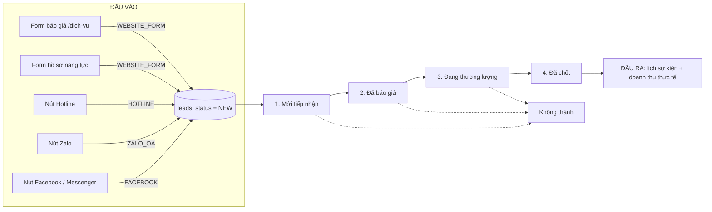
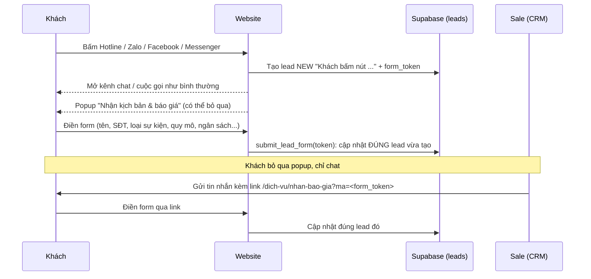

# Sitemap và quy trình phân hệ

## Sitemap website

```text
Website công khai
├── /                         Trang chủ
├── /ve-chung-toi             Giới thiệu doanh nghiệp
├── /dich-vu                  Dịch vụ, ưu đãi và form nhận báo giá
│   └── /dich-vu/cam-on       Xác nhận sau khi gửi form (không đưa vào sitemap)
└── /tin-tuc                  Danh sách bài viết đã xuất bản
    └── /tin-tuc/[slug]       Chi tiết bài viết

Khu vực quản trị (cần đăng nhập, không lập chỉ mục)
├── /login                    Đăng nhập quản trị
├── /admin/dashboard          Tổng quan khách hàng, doanh thu và lịch sự kiện
├── /admin/leads              Tiếp nhận và xử lý khách hàng tiềm năng
├── /admin/services           Quản lý dịch vụ
├── /admin-radar              Phân tích đối thủ và tạo bài viết SEO
└── /admin                    Chuyển hướng về /admin/dashboard

API (không lập chỉ mục)
└── /api/radar                Phân tích nội dung đối thủ và tạo bài viết
```

`/sitemap.xml` được tạo bởi `src/app/sitemap.ts`. Sitemap gồm các trang công khai,
các bài viết mẫu đang được website hiển thị và bài viết có trạng thái `published`
trong Supabase. `/robots.txt` được tạo bởi `src/app/robots.ts`; khu vực quản trị,
đăng nhập và API được khai báo không cho crawler lập chỉ mục.

> Menu hiện có liên kết `/admin/portfolio`, nhưng chưa có trang tương ứng trong
> `src/app`; cần triển khai phân hệ hồ sơ sự kiện trước khi đưa route này vào sitemap.

## Quy trình dữ liệu giữa các phân hệ

```mermaid
flowchart TD
  V[Khách truy cập website] --> S[Trang dịch vụ /dich-vu]
  S --> F[Điền form nhận báo giá]
  F -->|INSERT| L[(Supabase: leads)]
  F --> T[/dich-vu/cam-on]
  L --> D[Admin dashboard]
  L --> M[Admin khách hàng tiềm năng]
  M -->|Cập nhật trạng thái, lịch, ngân sách, người phụ trách| L
  D -->|Tổng hợp KPI và lịch sự kiện| L

  A[Quản trị viên đăng nhập /login] --> P[Proxy xác thực]
  P -->|Phiên hợp lệ| AD[Admin dashboard]
  AD --> R[Radar SEO /admin-radar]
  R -->|POST| API[/api/radar]
  API -->|Phân tích đối thủ + tạo nội dung| R
  R -->|Lưu nháp / xuất bản| POSTS[(Supabase: posts)]
  POSTS -->|Chỉ bài published| BLOG[/tin-tuc]
  BLOG --> ARTICLE[/tin-tuc/[slug]]
  POSTS --> XML[/sitemap.xml]
```

### Phễu khách hàng (lead funnel)

Mọi định nghĩa của phễu (nguồn, giai đoạn, công thức chỉ số) nằm trong
`src/lib/lead-funnel.ts`. Form, API, dashboard và CRM đều dùng file này.



**Đầu vào.** Mọi lead mới đều có `status = NEW`.

| Kênh | Nơi phát sinh | `source` | Ghi chú |
|---|---|---|---|
| Form báo giá | `/dich-vu` (LeadForm) | `WEBSITE_FORM` | Có tên + SĐT thật |
| Form hồ sơ năng lực | `/ho-so-nang-luc` | `WEBSITE_FORM` | Có tên + SĐT thật |
| Nút Hotline | Header, Footer, nút nổi, form | `HOTLINE` | SĐT "Chờ cập nhật", sale tự xác minh |
| Nút Zalo | Footer, nút nổi, form | `ZALO_OA` | như trên |
| Nút Facebook / Messenger | Footer, nút nổi | `FACEBOOK` | như trên |
| Giới thiệu / Khác | Sale nhập tay | `REFERRAL` / `OTHER` | |

Nếu khách chỉ bấm nút, mỗi trình duyệt chỉ tạo **1 lead cho mỗi kênh trong 24 giờ**
để tầng 1 không bị phồng lên.

**Giai đoạn.** Sale đổi trạng thái tại `/admin/leads`.

| # | Trạng thái | Khi nào | Việc cần làm tiếp |
|---|---|---|---|
| 1 | Mới tiếp nhận (`NEW`) | Tự động khi khách gửi form / bấm nút | Gọi lại, gửi báo giá |
| 2 | Đã báo giá (`QUOTED`) | Đã gửi báo giá | Hẹn khảo sát, đàm phán |
| 3 | Đang thương lượng (`NEGOTIATING`) | Khách phản hồi, đang đàm phán / khảo sát | Ký hợp đồng + nhận cọc |
| 4 | Đã chốt (`WON`) | Đã ký hợp đồng và nhận cọc | Lên lịch, nhập doanh thu thực tế |
| — | Không thành (`LOST`) | Khách dừng ở bất kỳ bước nào | Ghi lý do vào ghi chú |

**Đầu ra.** Hiển thị trên `/admin/dashboard`.

- Mỗi tầng đếm **cộng dồn** các lead đã đi qua bước đó. Ví dụ: tầng 2 = Đã báo giá +
  Đang thương lượng + Đã chốt. Nhờ vậy số lượng giảm dần từ trên xuống và tỷ lệ
  chuyển tầng luôn ≤ 100%.
- Tỷ lệ chuyển tầng = số lead tầng sau ÷ số lead tầng trước.
- Tỷ lệ thắng = Đã chốt ÷ (Đã chốt + Không thành).
- Chuyển đổi toàn phễu = Đã chốt ÷ tổng lead.
- Đang xử lý = Mới + Đã báo giá + Đang thương lượng.
- "Không thành" là nhánh rơi khỏi phễu. Lead này chỉ được tính ở tầng 1 vì hệ thống
  chưa lưu lead rơi ở bước nào.
- Biểu đồ nguồn khách phân loại theo cột `source`.

### Thu số điện thoại khi khách bấm nút liên hệ



- Mọi form (`/dich-vu`, popup, link gửi khách) đều gửi về `POST /api/leads`. API này dùng
  bộ trường chung trong `src/lib/lead-form-options.ts`.
- Nếu khách chỉ chat, không điền form, sale nhập SĐT trực tiếp trong hồ sơ lead (mục
  "Thông tin liên hệ"). Khách gọi thẳng thì dùng nút "Thêm lead thủ công".
- CRM gắn nhãn "Chưa có SĐT" và "Trùng SĐT". Lead trùng được gộp bằng nút "Gộp vào lead
  này"; lịch sử và báo giá được chuyển sang lead giữ lại.

### Ghi nhận tiến trình (migration `20261108000000_lead_crm_phase_a.sql`)

| Việc | Ghi nhận ở đâu | Tự động |
|---|---|---|
| Thời điểm vào từng bước | `quoted_at`, `negotiating_at`, `won_at`, `lost_at` | Trigger khi đổi trạng thái |
| Bước khách rời đi + lý do | `lost_stage`, `lost_reason` | `lost_stage` do trigger ghi; lý do bắt buộc nhập |
| Gọi / nhắn / gặp / ghi chú | `lead_activities` + `last_contacted_at` | Sale bấm "Ghi nhận liên hệ" |
| Báo giá | `lead_quotes` (phiên bản v1, v2…) | Lưu khi Chép gửi Zalo / Soạn Email / In PDF; lead "Mới" tự chuyển "Đã báo giá" |
| Nhắc việc quá hạn | Dashboard → "Việc cần làm" | Mới > 30 phút, Báo giá > 3 ngày, Thương lượng > 7 ngày không liên hệ; > 14 ngày đề xuất "Không thành" |

### Tự động hóa quy trình sale (migration `20261109010000_crm_ai_pricing.sql`)

| Thời điểm | Hệ thống tự làm | Sale còn làm |
|---|---|---|
| Khách gửi form / popup / link | AI (Gemini) chấm **Nóng / Ấm / Lạnh**, tóm tắt nhu cầu, liệt kê thông tin cần hỏi thêm, gợi ý gói, việc cần làm, **soạn sẵn tin nhắn**; báo ngay vào **nhóm Telegram** kèm link hồ sơ | Đọc Telegram, mở hồ sơ |
| Khách chỉ bấm Zalo / Facebook / Hotline | Báo Telegram "khách bấm nút …" | Kiểm tra tin nhắn kênh đó, gửi link form |
| Sale mở lead chưa được phân tích | AI tự phân tích ngay | – |
| Liên hệ khách | Nút "Chép tin nhắn & ghi nhận đã nhắn" chép tin AI soạn và tự ghi nhật ký + "Liên hệ gần nhất" | Dán vào Zalo / Messenger |
| Lập báo giá | Nút **"AI lập báo giá nháp"**: AI chọn hạng mục + số lượng từ **Bảng đơn giá** (`/admin/bang-gia`); giá luôn lấy từ bảng | Duyệt, sửa nếu cần, bấm gửi |
| Gửi báo giá / đổi trạng thái | Lưu phiên bản, chuyển "Đã báo giá", **AI phân tích lại** và soạn tin nhắn cho bước mới | – |
| Việc cần làm (Dashboard) | Sắp **lead Nóng lên đầu**, hiện việc AI đề xuất cho từng lead | Xử lý theo thứ tự |

**Biến môi trường** (Vercel → Settings → Environment Variables, và `.env.local` khi chạy máy):

| Biến | Bắt buộc | Dùng cho |
|---|---|---|
| `GEMINI_API_KEY` | Có (đã có) | AI phân tích, AI lập báo giá, Radar SEO |
| `SUPABASE_SERVICE_ROLE_KEY` | Nên có | AI phân tích **ngay khi khách gửi form** (chạy nền). Thiếu: AI chạy khi sale mở lead |
| `TELEGRAM_BOT_TOKEN`, `TELEGRAM_CHAT_ID` | Nên có | Thông báo lead mới vào nhóm Telegram |

Model AI: `gemini-3.5-flash` (suy nghĩ mức thấp, ~4 giây), dự phòng `gemini-3.1-flash-lite`, `gemini-flash-latest`
(`src/app/api/radar/services/gemini-client.ts`, dùng chung với Radar SEO).

### Luồng xử lý lead

1. Khách gửi form hoặc bấm nút liên hệ. Hệ thống ghi một lead `NEW` vào `public.leads`
   với nguồn tương ứng (xem bảng đầu vào ở trên).
2. Dashboard và trang `/admin/leads` đọc cùng bảng `leads`; dashboard tổng hợp phễu,
   nguồn khách, doanh thu và lịch sự kiện.
3. Nhân viên chuyển trạng thái theo bảng giai đoạn, đồng thời cập nhật lịch tổ chức,
   ngân sách và người phụ trách. Các thay đổi này là dữ liệu cho dashboard.

### Luồng nội dung SEO

1. Quản trị viên đăng nhập và mở `/admin-radar`.
2. Radar gửi URL đối thủ, từ khóa và yêu cầu phân tích tới `/api/radar`.
3. Quản trị viên xem phân tích, chỉnh sửa nội dung rồi lưu nháp hoặc xuất bản vào
   `public.posts`.
4. Trang `/tin-tuc` chỉ hiển thị bài đã xuất bản; route chi tiết dùng slug bài viết.
5. `/sitemap.xml` lấy các slug đã xuất bản để crawler tìm thấy nội dung mới.

### Quyền truy cập

- `src/proxy.ts` yêu cầu phiên Supabase Auth cho `/admin/*` và `/admin-radar/*`.
- Dashboard và phân hệ quản trị đọc/ghi dữ liệu qua Supabase, chịu sự kiểm soát của
  Row Level Security (RLS).
- Khách công khai chỉ gửi lead từ form; không được cấp quyền đọc danh sách khách hàng.
